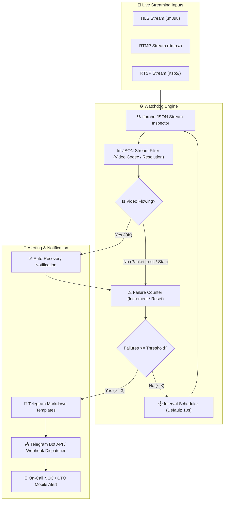

# 📡 stream-health-watchdog

> **Topics:** `stream-monitoring` `ffprobe` `iptv` `hls-monitor` `telegram-alert` `broadcasting` `devops`


[](https://github.com/shadialhasan/stream-health-watchdog/releases/tag/v1.0.0)
[](https://github.com/shadialhasan/stream-health-watchdog/actions)
[](LICENSE)
[](https://github.com/shadialhasan)
[](https://python.org)

A production-proven watchdog daemon designed for 24/7 broadcast operations (Satellite downlinks, IPTV channels, and OTT live streaming). Actively probes streams for bitrate stalls, dropped video packets, and automatically triggers recovery workflows or Telegram emergency alerts.

---

## 🏗️ Architecture & Operational Flow



---

## ✨ Features

- **Multi-Protocol Monitoring:** Native support for HLS (`.m3u8`), RTMP, and RTSP feeds.
- **Deep JSON Stream Inspection:** Uses `ffprobe` to analyze stream codecs, resolution, frame rate, and container metadata.
- **Consecutive Failure Thresholding:** Suppresses false alarms by triggering alerts only after $N$ consecutive failed checks (default: 3).
- **Automated Recovery Alerts:** Instantly notifies operators when a down feed restores stability.
- **Rich Telegram Alert Templates:** Formatted Telegram Markdown notifications with stream status, failure count, timestamp, and diagnostics.
- **Configurable Environment:** Full `.env` support with zero mandatory third-party dependencies.
- **Automated CI/CD:** GitHub Actions workflow executing unit tests across Python 3.10, 3.11, and 3.12.

---

## ⚙️ Configuration

Copy `.env.example` to `.env` and set your credentials:

```bash
cp .env.example .env
```

Configuration variables:

| Variable | Description | Default |
| :--- | :--- | :--- |
| `STREAM_URL` | Target stream URL (HLS / RTMP / RTSP) | Required |
| `CHECK_INTERVAL` | Polling interval in seconds | `10` |
| `FAILURE_THRESHOLD`| Consecutive failure count to trigger alert | `3` |
| `TELEGRAM_BOT_TOKEN`| Telegram Bot Token from @BotFather | Optional |
| `TELEGRAM_CHAT_ID` | Telegram Chat/Channel ID for alerts | Optional |
| `TELEGRAM_WEBHOOK` | Generic HTTP Webhook endpoint | Optional |

---

---

## ⚙️ Installation & Setup

```bash
git clone https://github.com/shadialhasan/stream-health-watchdog.git
cd stream-health-watchdog
pip install -r requirements.txt
```

## 🚀 Usage

### 1. Monitor Live Stream via CLI
```bash
python watchdog.py --url "https://live.example.com/hls/channel1.m3u8" --interval 10 --threshold 3
```

### 2. Inspect Stream Details (JSON Filtering)
```bash
python watchdog.py --url "https://live.example.com/hls/channel1.m3u8" --filter-json
```

---

## 🧪 Testing & CI/CD

Run test suite locally:

```bash
pytest -v
```

GitHub Actions pipeline (`.github/workflows/ci.yml`) runs on push and pull requests against Python 3.10, 3.11, and 3.12.

---

## 👤 Author & Maintainer

**Eng. MHD. Shadi AL-Hasan**  
- **Role:** Executive CTO & Enterprise Solutions Architect  
- **Email:** [mhd.shadi.alhasan@gmail.com](mailto:mhd.shadi.alhasan@gmail.com)  
- **Phone / WhatsApp:** [+963934005922](tel:+963934005922)  
- **Location:** Damascus, Syria  
- **GitHub:** [shadialhasan](https://github.com/shadialhasan)  

---

## 📄 License

This project is licensed under the MIT License - see the [LICENSE](LICENSE) file for details.  
Copyright (c) 2026 **MHD. Shadi AL-Hasan**. All rights reserved.